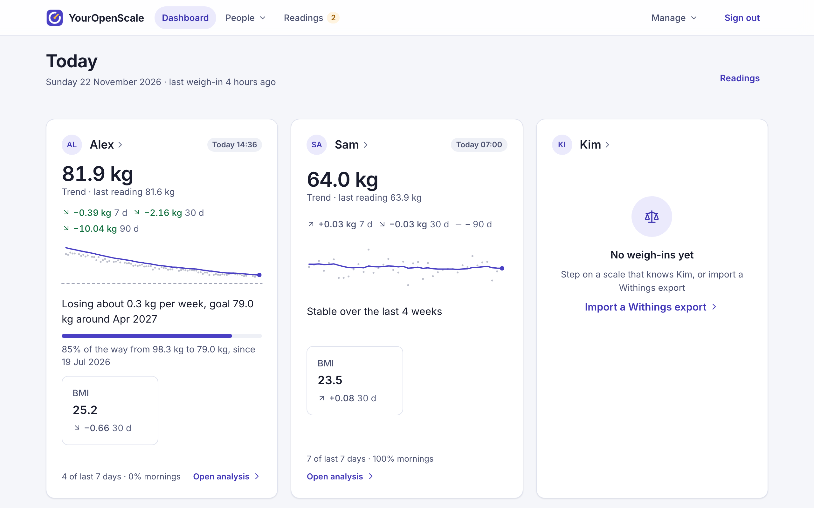
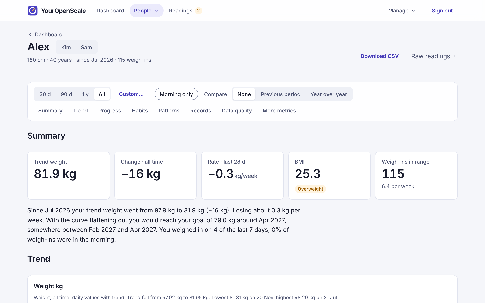

# YourOpenScale (YOS)

**Your scale, your data, your server.** YourOpenScale lets Withings Wi-Fi scales report to a server you run yourself, and turns the readings into trends, goals and projections that are computed on that same server.

> Built on [YourOwnWeigh](https://github.com/TomAnthony/YourOwnWeigh) by Tom Anthony (MIT), who worked out how to talk to the scales and wrote the firmware patches and the Bluetooth bridge. See [Credits](#credits).



## Why

Three things matter here, in this order:

- **Your data.** Every weigh-in is stored in one SQLite database (or your own Cloudflare D1) that you own. Download it any time (Settings → Backup and restore → Export database), export a person's series as CSV, or import a Withings data export to bring your history along. Nothing goes to a third party.
- **Your server.** The scale talks to a server you operate: at home, on a NAS, or on a small VPS, under your own domain and TLS. No account, no subscription, no vendor app. The web pages load everything from your own server (enforced by a Content-Security-Policy), so there are no CDNs, web fonts or analytics. The only outbound requests are optional ones you trigger yourself, such as fetching a Withings export or the stock firmware that gets patched.
- **Your analysis.** Trend, rate of change, goal projection, weekly rhythm, records and data-quality checks are calculated on your server from your readings. The formulas are open ([`server/ts/analysis/`](server/ts/analysis/)), explained on each overview page ("How the numbers are calculated"), and assumptions are labelled as assumptions. A sync API ([`contracts/`](contracts/readings/v1/README.md)) hands the raw readings to Apple Health or your own tools for analysis of your own.

## What you get



- A dashboard with one card per person, and a detailed overview for each: smoothed trend weight, rate over the last weeks, BMI, body composition where the scale measures it, weekly rhythm, records, and a data-quality check that flags implausible readings.
- Goals with a start date and start weight, progress since the start, and a [projection](#goal-projection) of when you will get there.
- Several people on one scale, readings assigned to the right person.
- English and German interface, selectable date and time formats, light and dark theme.
- Installable as an app on desktop and phone (HTTPS required). Offline you only get a placeholder page; readings and pages are never cached by the service worker.
- Import of Withings data exports, CSV export, database backup and restore.
- Sync API and a Shortcut for Apple Health.
- Docker deployment behind your own reverse proxy, with a [one-command deploy script](docker/FORK-DEPLOY.md) for your own host.

## Goal projection

Losing weight is not a straight line: the first kilos come off fast, and it slows down towards a healthy weight, at lower body fat and with age. The projected date takes that into account.

1. If your own history since the goal start already shows a flattening curve, that curve is used. It is fitted as an exponential approach and only accepted when it clearly beats a straight line; the date range comes from the uncertainty of the fit.
2. Otherwise, for weight loss, the pace is assumed to ease off in proportion to what is left above a floor weight. The floor is the weight at a BMI of 21 (a little higher with age) or, when body fat is measured, the weight at which your lean mass would carry the minimum healthy fat share, whichever is higher. These numbers are rules of thumb, not medical advice. They are constants at the top of [`server/ts/analysis/trend.ts`](server/ts/analysis/trend.ts).
3. The straight-line date at your current rate is shown as the earliest estimate. If the curve settles above your goal, the page says that instead of inventing a date.

## Supported scales

| Scale | Model | Stock firmware | YOS firmware | Contributed by |
| --- | --- | --- | --- | --- |
| Body Smart | WBS13 | v1311 | v103 | |
| Body | WBS06 | v1181 | v127 | |
| Body+ | WBS05 | v1651 | v100 | |
| Body Cardio | WBS04 | v2231 | v100 | [KindOfNerdy](https://github.com/KindOfNerdy) |
| Wireless Scale | WBS03 (WS‑30) | v921 | v102 | |
| Smart Body Analyzer | WBS02 (WS‑50) | v1721 | v1023 | [ionothanus](https://github.com/ionothanus), [pufnstuf](https://github.com/pufnstuf) |

The WS‑30 and WS‑50 only sync over plain HTTP. Look for the model number under the batteries: scales sold under the same name can differ. Adding another model is described in [CONTRIBUTING.md](CONTRIBUTING.md).

## How the pieces fit

- **Server** (`server/`): the dashboard, the API the scale talks to, the sync API for reading data out, and the firmware management pages. Runs as a Docker container, as a local Node process, or as a Cloudflare Worker with D1.
- **Bridge** (`bridge/`): a small Python program you run on a computer within Bluetooth range of the scale. It identifies the scale and carries the firmware update. macOS, Linux and Windows are supported; on Windows only Bluetooth LE scales work, because the Classic transport used by the WS‑30 and WS‑50 has no Windows port.
- **Firmware patches** (`firmware/`): per-model patches that make the scale report to your server. The Withings firmware itself is not in this repository; the server downloads it from Withings and patches it on request.
- **Connectors** (`connectors/`): an Apple Health Shortcut and helpers that pull readings out of the sync API.

## Setup

**1. Run the server.** Pick one:

- Docker (recommended for a 24/7 setup): [`docker/README.md`](docker/README.md). One container, plain HTTP, behind your reverse proxy that serves one subdomain.
- Locally for a first try: `npm ci && npm run setup:local -- --scale-host YOUR_LAN_IP`, then see [`server/README.md`](server/README.md). The scale only connects to ports 80 and 443, so a local run needs a small forwarder such as Caddy.
- Cloudflare Workers + D1: `npm ci && npx wrangler login && npm run setup:cloudflare -- --name SHORT-NAME --deploy`. Choose a short name, the full hostname must fit the scale's limit (see below). This path is inherited from upstream and is the least exercised in this fork.

Open the printed URL, enter the bootstrap token and set an admin password.

**2. Start the bridge** on a computer near the scale:

```sh
python3.11 -m venv .venv
.venv/bin/pip install ./bridge
.venv/bin/yow-bridge
```

It asks for an invitation code. Create one in the web app under **Firmware Bridge → Generate Connection Invitation** and paste it in.

**3. Import the scale.** Put the scale into setup mode with its button, scan (BLE, or Classic for older models), connect, and choose **Import Device To Server**. Its settings and user roster are fetched from Withings, so you continue where you left off.

**4. Flash the firmware** (read the next section first). **Generate Firmware** downloads the matching Withings version and patches it; check model and version, then **Send Update To Device** and type `FLASH`. Keep the scale powered and the bridge running until it is done.

**5. Point the scale at your server.** After the reboot, open the **Configure** pane, enter your server's hostname, choose the protocol (some models only do HTTP), and set the Wi-Fi if needed. Step on the scale and check **Readings** after 20 to 40 seconds.

## Before you flash

Flashing firmware can go wrong. The risks, as far as they are known:

- The models checked so far have two firmware slots and write an update to the one with the lower version. The YOS patches carry deliberately low version numbers, so one slot should keep the stock firmware. An interrupted write invalidates a slot, and the next attempt prefers that slot, so you can try again.
- A bad write can still take Bluetooth down. Then the scale needs a wired UART connection to be rescued; the tools for that are in [`tools/README.md`](tools/README.md).
- Keep the original firmware and device backups before you flash. The inactive slot can still supply radio resources, so do not erase it casually.
- The scale only connects to ports 80 and 443, and the server hostname has a length limit: 48 characters on the WBS06, 59 on the WS‑30.
- The WBS06 encrypts HTTPS traffic but does not verify the server certificate. The WS‑30 uses plain HTTP; its secret is hashed but the readings travel in the clear. Keep such scales on a network you trust, and see [`docker/README.md`](docker/README.md) for a LAN-only HTTP route.
- To check which firmware is on a scale: connect with the app, or take a battery out for a moment. Stock firmware shows "Hello" when it powers up, YOS firmware shows a smiley.

## Development

```sh
npm ci
npm run server:typecheck      # TypeScript
npm run server:test           # unit and server tests
npm run dev                   # synthetic dev server with demo data, no real readings
npm run e2e                   # browser tests (Playwright)
tools/deploy.sh               # tests, backup, build, deploy, smoke check, rollback
```

Notes on releases and versioning are in [CONTRIBUTING.md](CONTRIBUTING.md), the changes per version in [CHANGELOG.md](CHANGELOG.md).

## How this fork was made

The changes in this fork (new UI, analysis and goal projection, German translation, Docker deployment and the deploy script, this documentation) were written largely by [Claude](https://claude.com/claude-code), Anthropic's AI coding assistant, working in Claude Code. The project was initiated and directed by [thenebu](https://github.com/thenebu), who runs it in production for their own scales.

Please keep that in mind when you rely on it: the code has an automated test suite (unit tests for the analysis, server tests, browser tests), but it has not had an independent human code review, and the projection assumptions are heuristics. Bug reports and reviews are very welcome.

## Credits

YourOpenScale would not exist without [YourOwnWeigh](https://github.com/TomAnthony/YourOwnWeigh) by Tom Anthony: the reverse engineering of the scale protocol, the firmware patches for each model, the Bluetooth bridge and the original server are his work, together with the contributors named in the table above and [mbragagnolo](https://github.com/mbragagnolo/), who ported the bridge to Windows. His project, README and [blog post](https://www.tomanthony.co.uk/blog/withings-yow-free-wifi-sync/) explain the background and are the place to follow the upstream work.

## License

MIT. Copyright (c) 2026 thenebu and YourOpenScale contributors, and (c) 2026 Tom Anthony and YourOwnWeigh contributors; see [LICENSE](LICENSE) and [`bridge/LICENSE`](bridge/LICENSE). Bundled third-party software is listed in [THIRD-PARTY-NOTICES.md](THIRD-PARTY-NOTICES.md).

Withings is a trademark of Withings SA. This project is not affiliated with, endorsed by or supported by Withings. Use it at your own risk.
